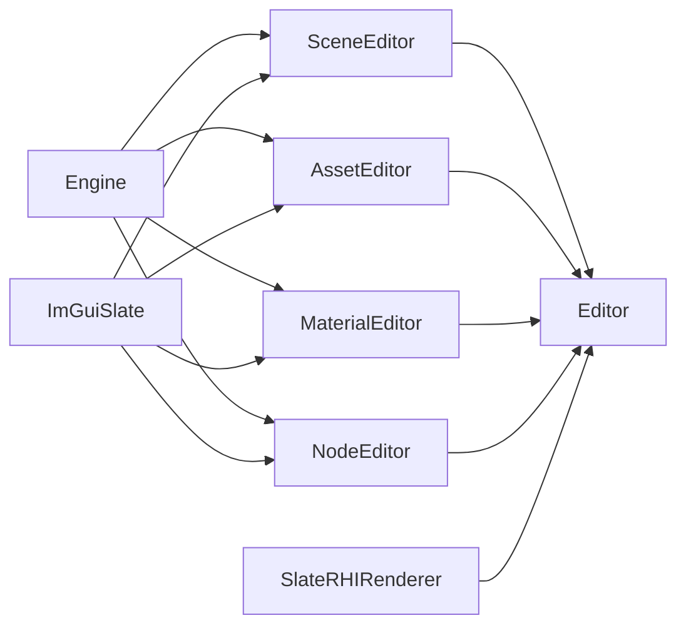

# Editor 编辑器应用

## 模块和边界

`src/Editor/CMakeLists.txt` 纳入 SceneEditor、AssetEditor、MaterialEditor、NodeEditor、Editor 五个独立 DLL。Editor 与原 Application 都提供 ApplicationBase 实现，由 Launcher 选择其一；Editor 负责工程生命周期、菜单与应用组装，功能面板由各自模块实现。

| 实现 | 职责 |
| --- | --- |
| [EditorModule.cpp](../../../src/Editor/Editor/Private/EditorModule.cpp) | 独占应用对象，初始化成功后发布 ApplicationBase，关闭时清空 |
| [EditorApplication](../../../src/Editor/Editor/Private/EditorApplication.cpp) | 唯一原生窗口、顶部 ribbon 与内容区域的组装布局、轮询绘制与按依赖释放 |
| [SceneEditor / EditorScene](../../../src/Editor/SceneEditor/Private/EditorScene.cpp) | 场景和组件所有者、ViewportClient、选择、复制、删除、相机与视图 |
| [SceneEditor / EditorScenePanel](../../../src/Editor/SceneEditor/PublicHeader/EditorScenePanel.h) | 场景节点列表、选择、复制、移除；视口拖放接收 |
| [SceneEditor / EditorViewToolbar](../../../src/Editor/SceneEditor/PublicHeader/EditorScenePanel.h) | ribbon 的 View 页、六向相机按钮、恢复自由视角与聚焦 |
| [AssetEditor / EditorAssetPanel](../../../src/Editor/AssetEditor/PublicHeader/EditorAssetPanel.h) | 文件系统树、当前目录资源网格、导航/筛选、资产加载与材质/纹理选择 |
| [MaterialEditor / EditorMaterialPanel](../../../src/Editor/MaterialEditor/PublicHeader/EditorMaterialPanel.h) | 按需打开的浮动材质编辑窗口，保留材质库/属性页 |
| [MaterialEditor / MaterialLibrary](../../../src/Editor/MaterialEditor/PublicHeader/MaterialLibrary.h) | 项目材质文件的元数据扫描、新建、复制与依赖文件导入，不持有运行时资产 |
| [NodeEditor / EditorNodePanel](../../../src/Editor/NodeEditor/PublicHeader/EditorNodePanel.h) | 借用当前 SceneComponent；网格编辑局部 TRS/材质槽信息，光源编辑位置和实际光照属性 |

## 依赖和模块协作



箭头从被依赖模块指向使用者。四个功能模块的公共接口导出到各自 PublicHeader，按目标名导出跨 DLL 接口。它们不依赖 Editor，也不相互依赖。Engine/ImGUISlate 不反向依赖任何编辑功能模块。NodeEditor 仅依赖 Engine/ImGuiSlate，通过同步查询/变更回调连接场景。

AssetEditor 不再保存 EditorScene 引用：打开网格时调用 SetOnMeshOpened 设置的回调；赋材质时调用 SetOnMaterialAssigned 设置的回调，由宿主决定目标和是否成功。无网格处理回调时明确报错，无赋材质处理回调时禁用该操作。

MaterialEditor 不再引用场景模块或资产面板类型。公共 MaterialEditorCallbacks 只包含查询当前组件、材质、纹理及通知变更的函数；EditorApplication 用 lambda 将这些接口连接到 SceneEditor/AssetEditor。Draw 时查询当前选择，避免额外缓存或固定一帧前的选择状态。函数在 UI 线程同步执行，组件指针只在当前调用中借用；没有异步回调或新资源管理器。

五个模块均通过既有 ModuleManager 注册并提供启动/关闭状态。功能模块不全局持有窗口、场景或面板，EditorApplication 显式拥有其实例；先销毁窗口、面板和场景，再关闭功能模块。模块实例存在，不代表应该为它创建新的全局业务单例。

### 光源节点与场景提示绘制

EditorScene::Object 的 Component 统一为 unique_ptr<SceneComponent>，网格和光源共用同一份节点列表、选择、聚焦和删除流程。GetSelected 返回通用组件；材质赋值、材质实例和网格复制通过 GetSelectedMesh 检查目标类型。新建/打开工程时保留原四类默认光源配置，作为 Directional light、Point light、Spot light、Sky light 节点显示；未打开工程时无节点，关闭工程会移除全部节点及工具借用。场景序列化仍未实现，重开工程会重新创建默认光源。

光源变换按实际语义显示：天空光没有变换区或编辑轴按钮；平行光提供 Position/Move 和 Rotation/Rotate；点光只有 Position/Move；聚光同时提供 Position/Move 与 Rotation/Rotate。光源不显示 Scale。方向/聚光的 Direction 与组件 +X 前向统一，直接改方向会更新局部 Euler，旋转输入或既有旋转圈拖动都会更新实际照射方向和代理；平行光默认示意位置为世界原点；Position 只移动箭头/图标和拾取位置，照明及照射方向不由位置决定。衰减范围独立于缩放，点/聚光提供范围，聚光提供以度显示的内外锥角。非天空光可编辑颜色、强度和投影开关。

天空光沿用工程默认环境资产，没有新增环境贴图选择器；现有 IBL 只消费纹理，颜色/强度控件明确禁用并提示尚不支持。当前注册即启用，Renderer::Scene 在 AddLight 时约束每场景最多一个天空光，包含待处理队列；再次注册同一对象幂等，第二个对象明确报错。更换时先移除当前天空光，再注册新对象，没有另加启用系统。光源复制暂不提供。

SceneEditor 通过 [SceneInterface::GetSceneSetting](../../../src/Framework/Engine/PublicHeader/SceneInterface.h) 开启 bDrawGrid/bDrawLightHints，并在 Select 时把选中光源写入借用的 LightHintTarget，选中网格或清除选择则置空。Renderer::RenderModule::BeginRender 在构图时快照该设置，在场景主体之后加入光源提示，再调用各视图 SceneViewDrawExtension，最后为所有视图加入网格。SceneEditor 的扩展只绘制变换工具及右上方向轴，不包含或链接 Renderer，CMake 和 apps.json 中均无直接依赖边；应用仍装配 Renderer 作为 RenderInterface 的运行时实现。

网格以视锥与地面交面的 XZ AABB 为范围，将 100×100 控制顶点映射到该区域；99×99 个区域分别按高度和观察距离选择 0.1～10 米间距，远处减少实际细分数量。同档实例合并绘制，线条在投影过密及距离较远处降低透明度，仍遵循远裁剪。当前由 CPU 选择区域档位、VS 展开，不使用硬件细分。网格在场景及全部视图扩展之后以 Load_Store 混合，RGB=线色×线 Alpha+已有颜色×(1-线 Alpha)，只写 RGB；空场景颜色初始化 Alpha=1，提示和变换工具保持该 Alpha，供 GUI 采样时不再二次淡出。点光为蓝色线框球，聚光为外锥底圆、16 条母线及沿方向的距离射线，平行光箭头含箭杆及八条头部线；天空光没有有限范围。几何、深度依赖及相机高度分级规则见 [算法](../../key_implemetion/algorithm/03-transforms-frustum-and-depth.md) 和 [提交与生命周期](../../key_implemetion/performance/08-ui-rendering-and-window-lifetime.md)。Renderer 不依赖 Editor，也不管理节点选择或窗口。

Editor 不改变 Asset 的资源所有权：组件引用 StaticMeshAsset/MaterialAsset，MaterialInstance 仅在真正编辑网格参数时按槽位创建，属于该组件。资产文件通过既有 AssetManager 加载；面板只保留当前选中的材质和纹理，不再建立一套资产缓存。

## 界面和操作

### 工程生命周期

菜单栏的 Project → New / Open 打开既有 ImFileDialogWidget 的目录选择界面，Cancel 不改变当前工程；Close 关闭当前工程而不退出应用。New 在选定目录创建 Content 及 RenderingLearn.project.json，不覆盖已有工程或非空 Content。Open 先验证描述和内容目录，再关闭旧工程，非法路径不会先清空当前工作区。描述格式为：

```json
{"version": 1, "name": "MyProject", "contentDirectory": "Content"}
```

运行时工程路径由 EditorApplication 保存，Core::GetProjectDir 仍表示引擎源码/内置资源根，不为项目切换改写全局路径或环境变量。关闭工程会清空场景节点/选择、资源树/过滤/历史、材质窗口与导入/投放的待执行操作，并释放资产管理器的驻留引用；仍被内置预览环境持有的资产继续有效。

工程描述目前只保存内容目录信息，不保存场景节点布局；重新打开会恢复资源浏览和四个默认光源，不恢复模型节点，场景保存/恢复尚未实现。源文件保留在原目录，Import 或桌面拖入 Assets 会复制到当前内容目录的新包中，重名用后缀避让。支持嵌入资源的 GLB、带本地依赖的 glTF、原生材质 JSON 和 PNG/JPG/BMP/TGA；glTF 的外部 buffer/image 与材质贴图一起复制并改为包内相对路径。外部依赖 GLB 明确拒绝，需导出为嵌入 GLB 或使用 glTF。

UI 确认只保存工程操作及路径，在下一 TickFrame 的绘制前执行；网格投放同样保存路径并延迟到下一帧创建，避免销毁本帧已经生成的纹理/资源引用。详细等待与所有权见 [UI 生命周期](../../key_implemetion/performance/08-ui-rendering-and-window-lifetime.md)。

窗口顶部先预留 24 像素菜单栏，再是 112 像素 ribbon，下面从左到右为 Scene、离屏 SceneViewport，以及选中节点时展开的 Node Properties；Assets 横跨整个窗口底部。没有选中组件时，右侧属性栏及其分隔条一起折叠，视口延伸到客户区右边缘，不保留空白列。材质编辑器作为浮动窗口显示，不占右侧固定区域。Editor 的局部 EditorLayout 通过 ImMainWindow::SetLayout 接入，保存两侧宽度和底部高度的比例，初始左右宽度为可用宽度的 1/7、2/7，底部为可用高度的 35%。可见区域间留出 6 像素分隔条；尺寸改变或拖动时统一重算几何，浮动材质窗口不被布局器覆盖位置。

两条竖向分隔条控制 Scene/Viewport 和 Viewport/Node Properties 的宽度，横向分隔条控制上方区域与 Assets 的高度。悬停/按住时显示对应的左右或上下系统拉伸光标，左键拖动实时调整相邻区域，松开或失焦结束。菜单和 ribbon 高度固定。常规客户区下最小宽度为 Scene 160、Viewport 240、Node Properties 260；最小高度为上方 220、Assets 140 像素。客户区小于这些总尺寸时按比例缩小下限，避免负尺寸；窗口改变大小仍保留用户选择的比例。目前比例仅在本次运行中保存，不持久化到配置文件。

资产区采用左侧文件系统树、右侧资源网格，二者之间可拖动调整宽度。顶部为 Import、前进/后退、上级、刷新和路径栏，底部保留 Open / Add mesh、Assign material 与状态。初始没有打开的工程、场景节点或材质弹窗；视口显示清空背景、地面网格和方向轴。打开工程后默认光源作为实际场景节点显示，天空由其中的 Sky light 提供。仍共用一个 ImGui/RHI 绘制环境，没有新增原生子窗口。

- Scene：列表选择、复制与移除网格、聚焦所选对象。右侧 Node Properties 只在存在选中组件时显示，编辑其局部平移/旋转/缩放；空工程、未选中组件或移除最后一个节点后不生成属性窗口，也不命中该面板。折叠会将原栏宽和分隔条空间交给视口；重新选中时恢复已保存的右栏比例。复制保留材质资产和稀疏参数覆盖，但创建独立组件实例。
- Ribbon → View：Top / Bottom / Left / Right / Front / Back 六向切换，按钮第二行注明相机所在轴侧，当前固定方向高亮。Orbit 恢复默认斜向环绕角度，Focus selected 聚焦所选对象。切换保留当前焦点和距离，沿用既有透视投影；这里的六向视图不表示已实现正交编辑管线。
- 视口：左键点击模型选中最近几何命中，点击空白清空选择；只有按下/松开期间移动始终小于 4 像素且释放仍在视口内才触发。右键拖动环绕、中键平移、滚轮缩放。投影使用实际视口宽高比；场景通过既有 Renderer 绘制。
- 右上角方向示意属于 SceneEditor：EditorScene 向本帧 SceneView::DrawExtensions 加入回调，Private/EditorViewAxes 在同一 RDG 中以线列表绘制六条半轴、以缩放球面三角形绘制端点。+X 红、+Y 蓝、+Z 绿，负端点用对应淡色；只加载/保存场景颜色，不访问场景深度。默认最大 144 像素，随相机旋转，极小视口不显示。
- 各球中心以屏幕正向显示 +X/-X、+Y/-Y、+Z/-Z，悬停或按住的球及轴线变黄，沿用原球面明暗。标签由既有 ViewAxes Shader 的小字形生成，不增加字体纹理。EditorSceneViewportWidget 在 Draw 前用 ImGui 鼠标位置和 GUI 遮挡刷新 hover，移出视口/进入其他 GUI 区域会清除高亮；Window 仍独占事件路由与捕获，没有重复投递鼠标事件。
- 左键点击球体切换到其轴侧视图：+X/-X 为 Right/Left，+Y/-Y 为 Top/Bottom，+Z/-Z 为 Front/Back。按住任意球体拖动超过 4 像素后，水平位移叠加偏航、垂直位移叠加俯仰，保留按下时的相机基底、焦点和距离；松开不再触发点击。未打开工程时仍允许相机、坐标球和普通界面交互，只有导入、工程资产等操作要求有效工程。输入沿既有 Window → SlateWidget → SceneViewport → EditorScene 传递和捕获，失焦结束拖动。数学与命中规则见 [相机算法](../../key_implemetion/algorithm/03-transforms-frustum-and-depth.md)，构图及生命周期见 [UI 实现](../../key_implemetion/performance/08-ui-rendering-and-window-lifetime.md)。
- Node Properties 的 Position 行右侧 Move 按钮为当前节点启停位移工具。SceneEditor 的 [EditorTranslationGizmo](../../../src/Editor/SceneEditor/PublicHeader/EditorTranslationGizmo.h) 借用一个 SceneComponent，不要求目标类型是静态网格；EditorScene 的 SetTranslationTarget 要求目标属于当前场景。X 红、Y 蓝、Z 绿的世界轴约束单轴平移，原点旁的 XY/XZ/YZ 四边形约束双轴平移，悬停与拖动句柄黄色高亮；工具不随组件旋转或缩放。局部 Position 通过既有 SetWorldLocation 的父矩阵逆变换更新，旋转和缩放保持原值。
- Rotation 行的 Rotate 与 Scale 行的 Scale 分别启停 [旋转工具](../../../src/Editor/SceneEditor/Private/EditorRotationGizmo.cpp) 和 [缩放工具](../../../src/Editor/SceneEditor/Private/EditorScaleGizmo.cpp)，与 Move 互斥。缩放显示局部三轴、端点标记，以及各轴世界长度 50% 处中点之间的连线：LocalScale 绝对值为 1 时采用 55 像素参考尺度，各轴长度乘对应局部缩放分量的绝对值，负值不反转颜色轴方向。绘制和命中共用同一几何；连接线是参照，轴线和端点可选。按下时固定所选轴从原点向端点的屏幕方向，沿该方向向外拖动增大绝对缩放、向内拖动缩小，垂直于该方向的位移不影响倍率，仅写选中 LocalScale 分量。极小值或投影缩短可能低于现有 12 像素可操作下限，极大值可能触发裁剪限制，可通过属性数值恢复。旋转显示局部 X/Y/Z 三圆环，沿圆拖动改变局部旋转，起点、当前径向边与半透明扇形显示拖动角。轴色仍为 X 红、Y 蓝、Z 绿，悬停/按住为黄。
- 缩放和旋转使用父子纯旋转乘积显示局部方向，不从含负缩放/非均匀缩放的世界矩阵分解方向；它们保留局部 TRS 语义，不等同于父缩放下的世界刚体编辑。共用声明及投影/线条/颜色 Pass 留在既有 EditorTranslationGizmo.h/.cpp，仅新增上述两个实现文件，复用原 Shader。旋转支持连续角度，扇形最多填满一圈；当前没有吸附、撤销栈或整圈计数标签。
- 三种工具与方向示意使用同一个 SceneView 绘制扩展：先追加当前启用的变换叠加，再追加右上角方向轴；分别声明颜色附件 Load_Store，不读写场景深度。只有启用目标时构图，切换节点、取消选择、删除和清空场景会先解除借用。鼠标捕获沿用现有 Window；松开、失焦、相机切换/聚焦和 resize 结束拖动。NodeEditor 仅通过查询/设置回调接线，不依赖 SceneEditor；EditorApplication 负责组装。投影、命中和约束见 [变换工具算法](../../key_implemetion/algorithm/03-transforms-frustum-and-depth.md)，提交与对象寿命见 [UI 实现](../../key_implemetion/performance/08-ui-rendering-and-window-lifetime.md)。
- Assets：左侧参考文件系统树展开目录及其文件，右侧按当前目录显示带类型图标/名称/类型的资源卡片；双击进入目录或打开资产，材质单击打开浮窗。加载图片作为待赋纹理、将 glTF 加入场景、将已加载母材质赋给网格槽 0，继续使用原有回调。网格创建延至下一 TickFrame 的绘制前；实际加载仍同步执行，复杂资源会阻塞 UI。
- Material Editor：通常不提交绘制窗口；点击资源管理器中的材质后加载并打开浮动窗口，默认选中 Properties 页。关闭后不会因保留上次材质选择而自动重开，再次点击才重开。Library 页保留当前工程内容中的目录分类、搜索、卡片、新建、复制和应用能力。
- 从 Assets 材质卡片拖到场景网格表面，会将材质赋给鼠标射线最近命中组件的对应材质槽并选中该组件；拖到背景不赋值，也不回退到当前选择。操作覆盖组件该槽位的材质引用，不改共享网格默认材质、不创建材质实例，重新赋值会按既有 SetMaterial 清除该槽旧实例覆盖。仅支持当前渲染器已有的 Opaque 材质。
- Properties 保留参数继承/恢复、纹理选择/清除、CullMode、TwoSided、Lit/Unlit 和保存副本。打开库中资产后编辑母材质；Inspect mesh 切换到所选网格，只有实际修改参数时创建其独占实例。Assets 的材质/纹理选择仍经原有宿主回调接入。

保存副本不重命名资产，也不导出实例资产。路径已存在时拒绝覆盖；保存后可在 Assets 中刷新并加载。Opaque 以外的 Surface 绘制仍未实现，不通过界面静默启用。当前没有撤销重做、场景序列化、材质节点图或完整编辑器快捷键。

### 场景点击与光源图标

EditorScene 的 SelectAt 和 ApplyMaterialAt 共用 SceneView::MakeRay / SceneInterface::Raycast，材质投递取命中 MaterialIndex，不再在 Editor 中复制全场景三角形遍历。查询使用最近一次绘制的视图；网格使用已 Flush 的代理变换，光源沿用已有通知即刷新代理的时序，先得到命中再调用 Select，保证属性栏出现/消失引发的 resize 不改变本次射线。背景点击 Select(-1)，材质拖放未命中则保持选择和材质。选择继续复用节点列表和 NodeEditor 的既有连接，不新增选择管理器。

输入优先级为 GUI → 方向球 → 当前变换工具 → 光源图标 → 网格/光源范围的最近命中。普通左键先由 Window 捕获，在松开确认点击；拖动超过阈值、释放越界、失焦、resize、切换相机或其他鼠标操作取消待点击。变换工具拖动始终只编辑原对象，方向球点击始终只切换视图。查询不新增 GPU 等待，实际材质/变换修改仍沿用既有完成点。

非天空光在世界位置投影为半径 9 像素的实心菱形图标，点光蓝、聚光绿、方向光橙，选中为黄。BuildLightIcons 共用绘制和命中数据，图标按相机深度从远到近绘制，命中反向检查 `abs(dx)+abs(dy)<=9`。图标作为可见叠加不受模型深度遮挡，点击它会优先于后方网格；图标未命中时，SelectAt 以 All 查询点光范围球、聚光有限圆锥和平行光箭头线段，并与网格按最近距离比较。射线在范围内部时取前方出口交点，不把整个范围内的射线起点都判为零距离；范围较大时背景点击可能选中光源，只有没有任何命中才清空。材质投递保持 Meshes 查询，光源不会截获材质拖放。天空光不生成局部图标，仍从列表选择。图标与变换工具使用既有 GizmoDrawing Pass，不直接依赖 Renderer；复杂度及参数借用见 [输入与提交](../../key_implemetion/performance/08-ui-rendering-and-window-lifetime.md)。

方向切换属于 EditorScene，不依赖 Editor 或材质/资产面板。世界坐标 Y 向上：Top 从 +Y 看向 -Y，Bottom 相反；Left 从 -X 看向 +X，Right 相反；Front 从 +Z 看向 -Z，Back 相反。顶部/底部使用 -Z/+Z 作为屏幕 Up，避免 LookAtRH 的叉积退化。平移、缩放和 Focus 保留方向；右键环绕转回自由状态并从所选方向继续。详细公式见 [相机与坐标专题](../../key_implemetion/algorithm/03-transforms-frustum-and-depth.md)。

### 资源文件系统与卡片视图

Editor 宿主将当前工程的 Content 设为 `res://`，未打开工程时面板只显示提示、不浏览引擎资源。树中目录优先排列，文件按名称排序；点击文件同步选中卡片，材质单击即加载并通知弹窗，其他资源在双击/Open 时加载。左侧 Filter files 递归筛选并保留匹配文件的父目录，右侧 Search resources 只筛选当前目录；右侧还有类型过滤和尺寸设置。导航记录只保存当前会话。

路径栏接受 res://、当前目录下的相对路径以及内容根内的绝对路径；不能通过上级/路径栏越出内容根。Refresh 重新读取目录元数据，不执行资产原地热重载。右键卡片可打开或复制 res:// 路径。不可读、已删除、未支持的文件显示错误，界面继续运行。

文件夹、网格、纹理、JSON 候选材质、普通文件采用不同类型图标；不批量生成真实缩略图。JSON 是否为有效材质由 MaterialAsset 加载验证。目录树与网格共用 CPU 元数据，不增加第二套资产管理器。资源导入不自动生成节点；从 GLB/glTF 卡片拖到视口后，宿主在下一次绘制前加载并通过原 EditorScene::AddMesh 流程创建静态网格，初始位置为世界原点。详细边界见 [资产工程细节](../../key_implemetion/performance/05-assets-materials-and-instance-data.md)。

Assets 网格中的材质卡片支持拖放。单击/双击在松开且没有发生拖动时打开编辑器，避免按下时浮窗抢走拖动。载荷只保存 UTF-8 路径，视口同时接受网格与材质两种路径载荷；材质投递额外记录归一化落点，EditorApplication 下一次 Draw 前加载并调用 EditorScene::ApplyMaterialAt。SceneEditor 用最后绘制的 SceneView 反投影，经 SceneInterface::Raycast 对 LOD0 三角形求最近交点并取 MaterialIndex。数学与边界见 [射线拾取细节](../../key_implemetion/algorithm/01-ray-triangle-and-distance.md)，提交时序见 [UI 核心实现](../../key_implemetion/performance/08-ui-rendering-and-window-lifetime.md)。

### 材质库与桌面导入

将文件从资源管理器/桌面拖到已打开的 Material Editor 或其展开的 Material Library 中，导入到当前选中的目录分类；All materials 对应当前工程 Content。未显示的材质窗口不接收文件投递。支持项目 version 1 材质 JSON，以及 PNG/JPG/JPEG/BMP/TGA 图片。图片生成引用该图片的 Lit/Opaque BaseColor 材质；JSON 的 textureParameters 依赖一并复制并改为相对路径。目录、任意 JSON、USD/MaterialX 等格式明确报错，不冒充已支持。

导入使用独立新目录，重名加后缀，不移动或覆盖源文件。先复制依赖，再写 material.json；失败只清理本次新建的目标。UI 显示批次进度、失败原因，可取消尚未处理的文件。每帧最多处理一个文件，单个大文件的复制/解码仍同步阻塞该帧，未实现后台导入。

MaterialLibrary 只保存路径、名字、分类、ShadingModel、BaseColor 等 CPU 元数据；卡片是颜色球形示意，不是实际 PBR 材质缩略图，也不为整个库加载 GPU 资产。实际选择/导入仍由 Engine::AssetManager 加载，MaterialAsset/TextureAsset 保持资源所有权。Editor 通过 SetContentRoot 随工程切换库根，无工程时库为空；公共构造接口仍允许其他宿主指定根目录，不将 USD/贴图目录伪装成已导入材质。

原生拖放、路径副本、处理时序和失败边界见 [UI 工程细节](../../key_implemetion/performance/08-ui-rendering-and-window-lifetime.md) 及 [资产导入细节](../../key_implemetion/performance/05-assets-materials-and-instance-data.md)。

## 场景更新和同步

`EditorScene` 仅在增删、变换或材质编辑后刷新 pending updates，正常帧不重复重建实例块。由于现有场景刷新会替换 GPU 缓冲，编辑前读取视口输出纹理 Tracker 的具体 `(QueueType, Value)` 并 WaitValue；GUI 对它的最终采样记录覆盖此前场景提交。没有新增 WaitIdle 或全局 retained 列表。窗口 resize 沿用已有窗口完成点等待。

`Scene::NotifyComponentChanged` 对 Primitive 创建新代理并进入现有 keyed AddPrimitive 命令，在 Flush 时替换旧代理；只设 dirty 标志不能更新代理缓存。StaticMeshProxy 读取完整组件世界矩阵，SceneComponent 的矩阵读取接口因此为 const。未替换 RDG 的资源状态或 Pass 生命周期设计。

关闭先销毁窗口，由既有 ReleaseWindow 完成该窗口提交，再销毁面板、视口和场景；移除组件前先消费借用它的移除命令。RHI/Renderer 由模块依赖保证此时仍可用。更详细的时序见 [UI 工程实现](../../key_implemetion/performance/08-ui-rendering-and-window-lifetime.md)。

分隔条是 ImGUISlate 的 ImSplitterWidget，只负责当前 ImGuiContext 的命中、光标请求和拖动增量。布局比例仍属于 EditorLayout；回调只在数值实际改变时调用 ImMainWindow::UpdateLayout。三个分隔条在任何视口/面板绘制前登记，重新布局前等待上一窗口完成标记，再经既有 SetGeometry/SceneViewport::Resize 更新纹理。内部拖动不销毁窗口交换链，不添加 WaitIdle 或资源保活容器；边界达到下限时也不重复等待。

## 启动

`Langcher.exe` 默认 Editor；`Langcher.exe -app=Application` 保留旧应用，`-app=Editor` 显式选择编辑器，`-help` 显示可选项。参数只来自 argv，无环境变量回退。

[apps.json](../../../src/Lancher/apps.json) 是实际装配源，CMake configure 时 COPYONLY 到 BINARY_DIR。默认两应用均为 Vulkan，图形后端由所选条目的模块/依赖决定，不提供未经接入的 `-rhi` 参数。配置校验、依赖排序和 DLL 链接边界见 [启动实现](../../key_implemetion/performance/09-module-build-and-startup.md)。

Editor 条目显式列出四个功能模块：SceneEditor、AssetEditor、MaterialEditor、NodeEditor 的显式启动依赖均为 Engine，Editor 最后组装。Editor 经 SlateRHIRenderer 的现有启动依赖保证 Renderer 在创建场景前已启动、场景关闭后才关闭；这不是 SceneEditor 对 Renderer 的直接代码依赖。Application 条目不加载这些功能模块。Langcher 仍只通过 add_dependencies 建立应用构建前置，不把具体应用 DLL 静态导入到 EXE。

本轮验证及限制见 [2026-10-26 故障记录](../../dev/bugfix/故障与修复记录-2026-10-26.md)，界面实现存在不等于完成了全部鼠标、文本、DPI 交互验证。
