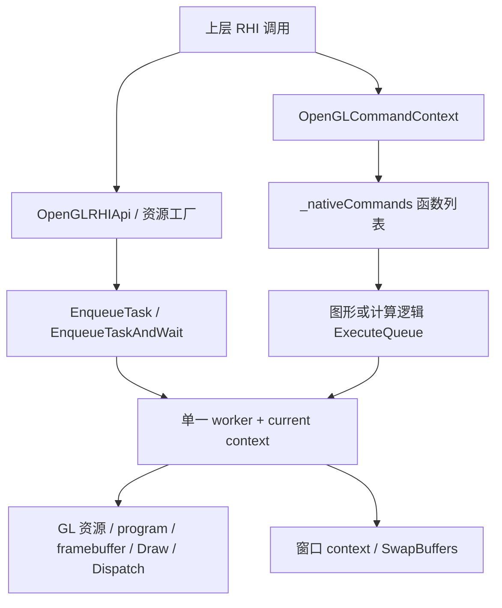

# RHIOpenGL 模块架构说明

## 1. 模块定位

`RHIOpenGL` 是 `RHI` 抽象层的 OpenGL 实现，把统一的资源、管线、命令列表、逻辑队列和呈现接口映射到 OpenGL 对象及调用。本文按当前源码说明实现思路，并单独标出未完成的能力；接口存在不等于已经具备对应后端功能。

与 Vulkan 后端的显式设备、原生命令缓冲和队列不同，当前 OpenGL 后端围绕“有效的 current context + 单一 worker 线程”组织执行。上层继续使用 `RHIApi`、`RHICommandList` 等抽象，由后端处理 GL 上下文和状态。

模块位于 `src/Framework/RHIOpenGL`，核心文件如下：

| 文件 | 职责 |
| --- | --- |
| `PublicHeader/OpenGLRHIApi.h`、`Private/OpenGLRHIApi.cpp` | 模块入口、资源工厂、上传读回与能力信息 |
| `Private/OpenGLPlatformSurport.h/.cpp` | Windows WGL 引导上下文、窗口上下文、GLAD 函数加载与 current context 切换 |
| `PublicHeader/OpenGLResource.h`、`Private/OpenGLResource.cpp` | 纹理、缓冲区、视图、shader、sampler、状态描述和 CPU staging |
| `PublicHeader/OpenGLPipelineState.h`、`Private/OpenGLPipelineState.cpp` | 图形/计算 program 的创建与链接 |
| `PublicHeader/OpenGLContext.h`、`Private/OpenGLContext.cpp` | 延迟命令录制、参数绑定、UBO 缓存、Draw/Dispatch 和 RenderPass |
| `PublicHeader/OpenGLQueue.h`、`Private/OpenGLQueue.cpp` | 逻辑队列、worker、软件时间轴、交换链和呈现执行器 |
| `Private/OpenGLRenderTarget.h/.cpp` | framebuffer 创建、附件挂接及状态检查 |
| `PublicHeader/OpenGLTransientResource.h`、`Private/OpenGLTransientResource.cpp` | 通用 RHI 资源池的 OpenGL 创建与回收条件 |
| `PublicHeader/OpenGLUtils.h`、`Private/OpenGLUtils.cpp` | 格式/纹理类型转换、GL 错误检查和光追不支持异常 |

`CMakeLists.txt` 将模块构建为动态库，依赖 `RHI`、`RenderCore` 和 `OpenGL::GL`，编入 GLAD。当前平台实现是 Windows/WGL，没有独立的 `OpenGLDevice` 类；设备相关职责分布在平台上下文和队列管理器中。

---

## 2. 功能入口与生命周期

### 2.1 `OpenGLRHIModule`

`OpenGLRHIModule : RHI::RHIModule` 通过 `IMPLEMENT_SIMPLE_MODULE(..., "RHIOpenGL")` 注册。启动时创建 `OpenGLRHIApi`、设置 `RHI::GRHIApi` 并调用 `Init()`；关闭时删除 API 对象并清除全局指针，API 析构调用 `Shutdown()`。

### 2.2 `OpenGLRHIApi`

`OpenGLRHIApi : RHI::RHIApi` 作为后端统一入口：

1. 设置 shader 平台为 `ERHIShaderPlatform::OpenGL`，平台信息报告 `DepthRange=ZeroToOne`、`bEnableRayTracing=false`。
2. 调用 `InitializePlatformSurport()` 创建引导上下文并加载 GL 函数。
3. 启动 `OpenGLQueueManager` 的 worker，后续通过它执行资源与命令操作。
4. 提供资源、shader、管线、视图、交换链、队列及瞬态管理器工厂。

`Shutdown()` 等待图形和计算逻辑队列的已提交条目执行完成，再停止 worker，最后释放平台引导上下文。它没有提供“任意线程、任意资源释放顺序都安全”的保证。资源和瞬态管理器应在有效上下文及 worker 存活期间清理。

目前模块启动未检查 `Init()` 返回值后再设置加载状态；API 初始化失败后的 worker 启动和清理也需要进一步检查。平台信息中的深度范围声明，仍需与实际 GL 裁剪/深度配置核对，不能仅凭该字段认定投影约定已完整落实。

---

## 3. 平台上下文与线程模型

### 3.1 引导上下文

`OpenGLPlatformSurport.cpp` 创建隐藏引导窗口和临时 WGL context，用其加载函数，再尝试创建 OpenGL 4.3 core context。初始化结束时主线程释放 current，由 worker 通过 `InitializeWorkerPlatformContext()` 接管常驻引导上下文。

交换链另外创建窗口对应的 `OpenGLPlatformContextWin32`，请求与引导上下文共享资源。呈现时切换到窗口 context，调用 `SwapBuffers()` 后解除 current，队列管理器再恢复 worker 的默认 context。

### 3.2 两种执行入口



- `EnqueueTask()`：异步任务，常用于按值捕获 GL handle 后删除资源。
- `EnqueueTaskAndWait()`：投递后等待 worker 执行，常用于需要立即获得句柄、编译结果或读回数据的操作。
- worker 内部再次调用上述接口会直接执行，避免 worker 等待自己。
- worker 未启动时，任务也会内联执行；这不保证调用线程具有有效 current context，初始化前和关闭后的调用需要约束。

通用任务队列 `m_TaskQueue` 和逻辑命令队列 `ExecuteQueue` 是不同队列。worker 每轮先排空任务，再尝试图形队列和计算队列，空闲时短暂等待。**两类队列之间没有统一的入队顺序保证**；同步任务完成，也不能代替等待此前尚未执行的命令条目。

当前同步任务包装会把异常保存进 promise，但等待端只调用 `future.wait()`，没有通过 `get()` 重抛；异步任务/命令执行也没有完整的错误传回协议。因此不能把“等待返回”理解为“操作一定成功”。

---

## 4. 资源实现体系

```text
RHITexture                 -> OpenGLTexture
RHIBuffer                  -> OpenGLBuffer
RHIShaderResourceView      -> OpenGLShaderResourceView
RHIUnorderedAccessView     -> OpenGLUnorderedAccessView
RHISampler                 -> OpenGLSampler
RHIStagingBuffer           -> OpenGLStagingBuffer
RHISwapchain               -> OpenGLSwapchain
```

### 4.1 纹理、缓冲区与视图

`OpenGLTexture` 保存纹理 GLuint，按纹理类型调用 `glTextureStorage1D/2D/3D` 创建存储；`OpenGLBuffer` 保存 buffer GLuint，创建时分配 GL buffer 数据空间。构造通常通过同步任务完成，析构通过异步任务删除 handle。

纹理 SRV/UAV 使用 `OpenGLTextureView`，通过 `glTextureView` 表达格式、mip 和 array slice 范围。参数绑定时，同一类原生纹理 view 根据 RHI 用途进入 texture unit 或 image unit。

Buffer SRV/UAV 当前保存描述信息，但 `ApplyShaderParameters()` 的对应分支没有实际 SSBO/纹理缓冲绑定。因此不能把视图对象构造成功视为 Buffer SRV/UAV 已实现。视图中的来源资源、录制命令中捕获的资源仍有原始指针，调用方需保持资源有效，后端保活机制尚不完整。

### 4.2 状态描述对象

`OpenGLVertexDescState`、`OpenGLRasterizerState`、`OpenGLColorBlendState` 和 `OpenGLDepthStencilState` 保存 RHI 描述。实际 GL 状态在图形上下文绑定管线时应用，不各自对应一个完整的原生 PSO。

`OpenGLStagingBuffer` 是 CPU 分配的暂存区域，并非 PBO 或 GPU 可见的映射 buffer。其 Map/Unmap、容量及释放语义仍需完善；不能套用 Vulkan staging allocation 的含义。

---

## 5. 着色器、program 与参数映射

### 5.1 编译和反射路径

当前 OpenGL shader 路径由 RenderCore 与后端共同完成：

```text
HLSL
  -> ShaderCompiler::CompileToOpenGL
  -> DXC 生成 SPIR-V
  -> SPIRV-Cross 生成 GLSL 430 和反射信息
  -> GLSLCompiledBinaryResultPacker
  -> OpenGLShaderBase 解包
  -> worker 上 glShaderSource / glCompileShader
```

`OpenGLShaderBase` 保存资源 binding、数组 count、资源类型及 UBO 声明大小。各 shader 派生类持有对应 GL shader handle。图形管线目前只把顶点和片元 shader attach 到 program；虽然几何、曲面细分 shader 工厂存在，当前图形 program 构造没有把它们接入。Mesh/Task shader 工厂返回 nullptr。

`OpenGLGraphicsPipelineState` 和 `OpenGLComputePipelineState` 分别创建、链接图形/计算 program。编译或链接失败会输出日志，但部分工厂未根据返回值拒绝对象，失败处理尚未形成一致契约。

### 5.2 参数绑定

`SetBatchedShaderParameters()` 将参数数据复制进命令 lambda，执行时由 `ApplyShaderParameters()` 绑定；参数容器复制并不等于资源对象生命周期已延长。

| RHI 参数 | 当前 OpenGL 映射 |
| --- | --- |
| Texture / 纹理 SRV | `glBindTextureUnit`，纹理 SRV 使用纹理 view 的 handle |
| Sampler | `glBindSampler` |
| 显式 UniformBuffer | `glBindBufferBase(GL_UNIFORM_BUFFER, ...)` |
| 离散 uniform 参数 | 写入 `UniformBufferCache`，再使用 `glBindBufferRange` |
| 纹理 UAV | `glBindImageTextures` 绑定纹理 view |
| Buffer SRV / UAV | 仅保存描述，绑定分支尚未实现 |

绑定槽位当前取 `Index + ArrayIndex`，shader 参数对象的阶段没有参与绑定选择。因此编译输出的 binding、combined sampler 与各 shader 阶段的槽位约定必须保持一致，不能假设具有 Vulkan 独立 descriptor set 的隔离语义。

### 5.3 UniformBufferCache

每个命令上下文维护 UBO 缓存，默认以 64 KiB chunk 分配 buffer。每个 binding 对应其中一段，按 `GL_UNIFORM_BUFFER_OFFSET_ALIGNMENT` 对齐，再根据 `BaseIndex` 写入成员。

段大小同时考虑实际写入范围与 shader 反射的 UBO 声明大小；VS/FS 对同一 binding 的大小提示取较大值。切换管线或开始新一轮录制时重置映射/游标，保留 chunks 以复用分配。

该缓存目前没有按原生 GPU fence 管理分段复用，析构还直接调用 GL 删除函数，相关线程与 GPU 完成条件需要单独核对。

---

## 6. 命令上下文与 RenderPass

```text
RHIContextBase
    -> OpenGLCommandContext
        -> OpenGLComputeContext
        -> OpenGLGraphicContext
```

`Begin()` 清空 `_nativeCommands` 并重置 UBO 缓存；`End()` 当前为空。Draw、Dispatch、纹理复制、blit、参数绑定及 RenderPass 操作记录为函数对象，提交后由 worker 依次调用。这里的 `_nativeCommands` 是 CPU 回调列表，不是驱动提供的原生命令缓冲。

图形管线绑定时创建/绑定 VAO、使用 program，并应用顶点布局、拓扑、光栅化、深度及混合状态。RenderPass 使用 `OpenGLFramebuffer` 挂接颜色/深度附件、设置 draw buffers 并按描述清理，结束时解除 framebuffer 和部分动态状态。

当前状态与绘制实现存在简化：深度比较使用固定的 GL_LESS，混合使用固定的 alpha blend；Draw/DrawIndexed 把顶点/索引数量乘以 instanceCount，没有完整的原生实例化语义，部分 base vertex/first instance 参数也未落实。

CopyTexture 主要沿二维图像路径执行 `glCopyImageSubData`；BlitTexture 通过临时读写 FBO 执行 `glBlitFramebuffer`。多层、不同纹理维度及子资源语义不能仅凭统一接口签名认定已经覆盖。

**资源转换目前尚未实现**：`RHICreateTransition()`、`RHIReleaseTransition()`、上下文 Begin/EndTransitions 都为空，没有建立访问状态校验，也没有把 RHI 访问变化转换成 `glMemoryBarrier`。GL 命令调用有顺序，不代表 shader 写入后的所有可见性依赖已被实现。

---

## 7. 队列、时间轴与完成语义

`OpenGLQueueManager` 是单例，同时实现 `RHIPresentExecutor`，管理 Graphics/Compute 两条逻辑队列和一个 worker；没有两条原生 GPU 队列，也没有独立异步计算实现。

提交过程如下：

1. `AcquireCommandContext()` 从空闲池获取或创建上下文。
2. `ExecuteContext()` 复制上下文指针和等待信息到 `QueueExecuteEntry`，分配单调递增的 FenceValue，并登记在飞上下文。
3. worker 检查队首等待值，依次执行该条目上下文的 `_nativeCommands` 或呈现回调。
4. 执行结束后将上下文归还池，并推进 `OpenGLSyncPoint::m_CurrentValue`。

在飞集合用于阻止主线程提前把同一上下文重复归还池；它不代表命令引用的全部资源都已被后端持有。

`OpenGLSyncPoint` 使用 atomic 计数、mutex 和 condition variable。WaitValue/WaitIdle 等待的是 worker 执行进度，当前没有对应的 `GLsync`/`glFenceSync` 完成点，**不能将其等同于 GPU 已完成全部命令**。有限超时的 Wait 当前也没有把超时结果报告给调用方。

等待信息按逻辑进度值判断，未实现精细的 pipeline stage 等待。开发和资源回收需要区分“CPU 已录制”“worker 已发出 GL 调用”“GPU 已执行完成”三种状态。

---

## 8. 交换链与呈现

`OpenGLSwapchain` 用三个普通 `OpenGLTexture` 模拟 RHI 可获取的 back-buffer slot，并为窗口创建共享 WGL context。Acquire 返回当前内部纹理及软件 ReadySync；这里没有 DXGI/Vulkan 式的原生交换链图像 acquire。

呈现由队列管理器加入图形逻辑队列：切到窗口 context，将当前内部纹理挂接到 framebuffer，再 blit 到窗口默认 framebuffer 并调用 `SwapBuffers()`，轮转内部纹理索引，最后恢复 worker 的常驻 context。

当前内部纹理尺寸沿用传入的 width/height；窗口平台 context 虽查询客户区，但还没有统一为内部纹理和呈现范围的真实尺寸。Resize 会重建内部纹理，也没有完整的原生 GPU 完成同步。ReadySync 目前不能证明某个内部纹理的上一轮 GPU 使用已结束。

FBO/VAO 等对象还需要按实际使用的 GL context 检查归属；不能仅因纹理处于共享组，就假设所有上下文相关对象都能直接跨 context 使用。

---

## 9. 上传、读回与瞬态资源

### 9.1 上传与读回

UpdateTexture/UpdateBuffer 直接通过同步任务调用 `glTexSubImage2D` / `glBufferSubData`，当前忽略传入的 cmdList，不会作为命令加入该列表。MapReadTexture/MapReadBuffer 分配 CPU 内存，通过同步任务调用 `glGetTexImage` / `glGetBufferSubData`，由 API 的 Unmap 释放。

这些接口等待的是自身任务完成，任务与 ExecuteQueue 又不共享统一 FIFO。因此在读取已提交 Draw/Dispatch 的结果之前，必须核对命令与任务的先后关系，不能只依据 cmdList 参数推导顺序。纹理读回也以二维、单个 mip 的实现为主，尚不能声称完整覆盖数组/三维区域及行对齐。

### 9.2 通用管理下沉，OpenGL 负责创建和回收条件

`OpenGLTransientResourceManager` 继承 RHI 通用管理器，复用其描述匹配、获取/释放、引用检查、统计及垃圾回收逻辑；后端只覆盖：

- `CreateTextureInternal()`：创建普通 OpenGLTexture。
- `CreateBufferInternal()`：创建普通 OpenGLBuffer。
- `CanRecycle()`：在非 worker 线程等待两个逻辑队列，再向 worker 投递 `glFinish()`；worker 内回收检查保守返回 false。

管理器析构同样等待 GPU、清理缓存，再等待任务队列中的删除任务完成。这里提供的是完整 GL 资源对象池，没有可显式绑定的 Vulkan device-memory heap，也没有基于生命周期区间的原生内存 aliasing。

`glFinish()` 为回收提供保守完成条件，但可能造成停顿；通用引用检查也不能替代所有视图/录制命令的保活，仍需结合调用方生命周期约束使用。管理器应先于后端和 worker 销毁。

---

## 10. 枚举转换与后端辅助

RHI 格式与纹理类型转换主要集中在 `OpenGLUtils`：

| 转换目标 | 函数 |
| --- | --- |
| 纹理存储内部格式 | `ConvertRHIFormatToGLInternalFormat` |
| 上传/读回像素格式和类型 | `GetOpenGLTextureFormat`、`GetOpenGLTextureType` 等 |
| 纹理目标 | `ConvertRHITextureTypeToGLTextureType` |
| GL 错误检查 | `CheckError` |
| 光追不支持路径 | `ThrowRayTracingUnsupported` |

当前顶点格式和部分拓扑/光栅化状态仍在 OpenGLContext 的局部函数或分支中转换；WGL 像素格式也由平台文件处理。后续新增公共的 RHI 到 GL 枚举映射应沿用 Utils 的集中组织方式，不能把这一目标误写为现有映射已全部集中。

---

## 11. 能力边界与验证方式

| 能力 | 当前实现状态 |
| --- | --- |
| 基础图形/计算 | 有 program、资源、命令与呈现路径，尚有上述状态和参数限制 |
| 纹理 SRV/UAV、UBO | 有实际绑定路径，仍需验证格式、槽位、范围与可见性 |
| Buffer SRV/UAV | 对象有描述，实际绑定未实现 |
| 几何/曲面细分 shader | 有 shader 包装/工厂，图形 program 尚未接入这些阶段 |
| Mesh/Task shader | 工厂返回 nullptr |
| RHI transition | 空实现，未建立完整访问/屏障契约 |
| 队列同步 | worker 软件时间轴，不是原生 GPU fence |
| 瞬态资源 | 通用池 + GL 对象创建，回收时 glFinish，无 heap aliasing |
| 光线追踪 | bEnableRayTracing=false，相关资源、管线和上下文接口明确抛错；按已确认范围暂不实现软件光追 |

平台请求 4.3 context，但资源实现还使用 `glCreateTextures`、`glBindTextureUnit`、`glBindImageTextures` 等入口；当前应进一步核对版本/扩展及函数指针可用性，不能只依据初始化日志中的版本号判断整个后端可运行。

通过统一测试入口选择后端：

```powershell
.\Tests.exe -test=RHIRenderTriangleTest -rhi=OpenGL
.\Tests.exe -test=RHIShaderParameterTest -rhi=OpenGL
.\Tests.exe -test=RHIRayTracingTest -rhi=OpenGL
```

以上是后端选择示例，不代表这些测试均已通过。光追应明确报不支持；最近两次运行在报错后又发生原生异常退出 `0xC000041D`，根因尚未确认，见 [故障记录](../../dev/bugfix/故障与修复记录-2026-10-21.md) 和 [优化点 OPT-13](../../dev/optimize/优化点-2026-10-21.md)。本次文档按源码核对，没有新增运行验证，也没有修改后端实现。

维护时应分别检查上下文归属、GL 函数可用性、命令/任务排序、shader binding、资源可见性和销毁顺序。具体故障及后续改进保留在 `Doc/dev`，架构文档负责描述当前模块职责和实现边界。

## 12. 源码入口

- [OpenGLRHIApi.cpp](../../../src/Framework/RHIOpenGL/Private/OpenGLRHIApi.cpp)
- [OpenGLPlatformSurport.cpp](../../../src/Framework/RHIOpenGL/Private/OpenGLPlatformSurport.cpp)
- [OpenGLQueue.cpp](../../../src/Framework/RHIOpenGL/Private/OpenGLQueue.cpp)
- [OpenGLContext.cpp](../../../src/Framework/RHIOpenGL/Private/OpenGLContext.cpp)
- [OpenGLResource.cpp](../../../src/Framework/RHIOpenGL/Private/OpenGLResource.cpp)
- [OpenGLTransientResource.cpp](../../../src/Framework/RHIOpenGL/Private/OpenGLTransientResource.cpp)
- [ShaderCompiler.cpp](../../../src/Framework/RenderCore/Private/ShaderCompiler.cpp)
