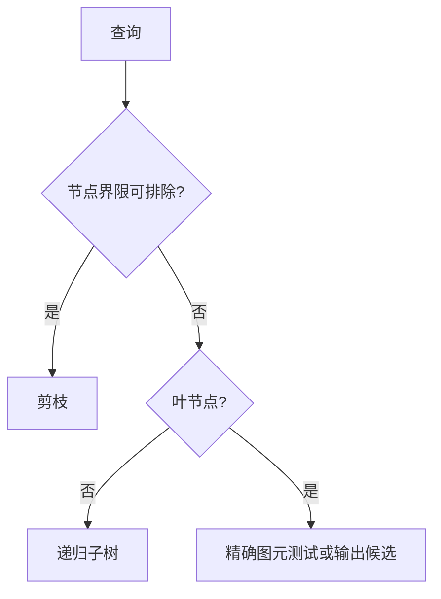

# BVH、八叉树与场景可见性查询

源码：[BVH.hpp](../../../src/Framework/Core/PublicHeader/BVH.hpp)、[BVH.inl](../../../src/Framework/Core/PublicHeader/BVH.inl)、[Octree.hpp](../../../src/Framework/Core/PublicHeader/Octree.hpp)、[Scene.cpp](../../../src/Framework/Renderer/Private/Scene.cpp)、[GlobalDiffuseLightMap.cpp](../../../src/Framework/Renderer/Private/GI/GlobalDiffuseLightMap.cpp)。架构入口：[Core](../../architecture/core.md)、[Renderer](../../architecture/render/renderer.md)。

## 先区分三套结构

| 实现 | 图元 | 主要用途 |
| --- | --- | --- |
| Core::BVH | Traits 参数化的外部数组 | 当前主要用于三角形距离/射线与距离场 |
| Core::Octree | Traits 参数化图元 | 体素/空间数据候选组织 |
| Renderer::SceneAccelerationStructure | PrimitiveSceneProxy 指针 | CPU 视锥可见性与射线候选 |

以上均不是硬件 BLAS/TLAS；驱动 AS 的构建与同步见 [工程专题](../performance/07-ray-tracing-as-and-sbt.md)。

## Core BVH 的数据布局和所有权

Build 借用 `const vector<Primitive>*`，只拥有 nodes 和 primitiveIndices，**不复制图元数组**。外部 vector 对象和图元必须覆盖查询期，不可在 Build 后销毁、移动其容器或无约束修改图元。索引重排不会改写原图元。

BVHNode 有 Bounds、左右 child 下标、FirstPrimitive、PrimitiveCount；leaf 用无效 left child 标识。leaf 的 FirstPrimitive 是重排索引数组的位置，不是原图元 ID；最终要再解引用 primitiveIndices。

## 构建：最长轴与中位数

1. 空输入 Clear 后返回；初始化 [0,N) 索引，reserve 约 2N nodes。
2. primitiveCount<=4 时建叶。
3. 合并当前范围图元 Bounds，按 AABB 半尺寸最长轴选择 x/y/z。
4. 用 Traits::GetCentroid 和 nth_element 按该轴的中位数划分。
5. 递归左右子树，内部 Bounds 合并两子节点。

这不是 SAH、Morton/LBVH 或空间切割 BVH。每层合并 Bounds 与选中位数通常线性，平衡情况下总工作约 O(N log N)，节点/索引空间 O(N)。实际查询最坏仍可能访问所有图元，不能写成保证 O(log N)。

## 三种查询的精确程度不同

- ClosestDistance：用点到 AABB 的距离作下界；若下界大于当前最小值则剪枝。leaf 调用 Traits::ClosestDistance 精确求距离。源码固定先左后右，没有近子树排序；较晚才得到较好上界会增加访问量。当前该入口没有空树保护。
- RayIntersect：先 slab-AABB，再 leaf 的 Traits::RayIntersect，返回所有命中图元 ID。set 去重的是 ID，不是交点 t；没有 nearest-hit early exit。
- GetPrimitiveIdsInsideBounds：节点 Bounds 相交就继续，leaf 将全部图元 ID 加入结果；**候选集合不保证每个图元实际与查询 box 相交**。调用方要做需要的窄相位测试。

## 八叉树：空间分割的前提

Octree 默认深度上限 8、每叶最多 8 图元，按 centroid 与 cell 中心比较，XYZ 三个位组成 childIndex，分入八个子 cell。数据仍借用外部 vector，索引归属一个子节点，最多深度限制避免无限细分。

该实现按质心分配整个图元，但 child Bounds 使用空间 cell。**若图元跨越 cell 边界，它可能伸出所属节点 Bounds**，此时射线/最近距离剪枝可能漏掉伸出的部分；必须确认调用数据是适配的点/小体素，不能把它当作对任意大三角形都保守的八叉树。

QueryBounds 的 leaf 同样输出候选；相交判据最终只用 AABB，BoxSphereBounds 同时带 Sphere 不代表每次都进行球测试。

## Renderer 场景 BVH 与更新

SceneAccelerationStructure 从可见 PrimitiveSceneInfo 收集 proxy，以 proxy bounds 质心中位数切分、每叶最多一个 primitive；reserve 2N，递归建立，Query 用 SceneView::IsBoxVisible 遍历。它有自己的重建和指针所有权约束，与 Core 的叶阈值不同。

射线重载 Query(ray,maxDistance,outPrimitives) 使用同一组节点，通过 Core::Ray::RayIntersectAABB 的有限区间逐层剪枝，叶子输出候选代理。它不将包围盒命中当作模型命中；Scene::Raycast 对候选做 LOD0 三角形精确求交，维护最近世界距离，并返回组件/Section/材质槽。没有复用 Core BVH 的 ID 集合作为最近命中，没有新增第二套场景索引。当前候选先收集为 vector，窄相位才更新最近距离；尚未按节点进入距离排序或动态缩短树遍历上界。复杂度、代理变换与接口约束见 [统一拾取](01-ray-triangle-and-distance.md)。

Scene 用 pending add/remove/change 队列把业务变更汇总，FlushPendingUpdates 更新渲染侧结构及 dirty 状态。proxy 仍涉及组件/资源借用，不能把“proxy”一词解释为整个场景已经线程隔离。

当前 GatherVisiblePrimitives 明确调用 CPU 分支。GPU frustum 路径存在、含上传/dispatch/读回和失败回退，但不是当前默认入口；HZB 也不能仅因有类声明就认为已经参与默认剔除。

## 检查方法与局限

可用暴力逐图元结果作为 oracle，分别比较最近距离、射线全命中和候选覆盖；需测试空树、退化图元、跨 cell、共享边和极端尺度。SDF 能生成纹理并不能证明奇偶求交或树剪枝正确。2026-10-31 已针对场景射线入口检查最近对象、有限距离、Flush 前后更新、负缩放/父变换和删除；这不等于对 Core BVH/Octree 全部查询执行了暴力对照，完整范围见 [当日记录](../../dev/bugfix/故障与修复记录-2026-10-31.md)。

光源范围查询未塞进原静态网格 BVH。Scene::Raycast 的 All/Lights 分支遍历 m_LightInfos，跳过不可见/空代理，按注册代理的位置、范围和方向做解析求交，再与网格候选结果比较。这样未引入新索引、缓存或光源范围变更后的重建协议，成本额外为 O(L)，平行光每项固定检查九条箭头线段。Meshes 默认查询及材质拖放不付出这段遍历成本；数学详见 [光源范围](03-transforms-frustum-and-depth.md)，更新时序见 [场景提交](../performance/08-ui-rendering-and-window-lifetime.md)。
