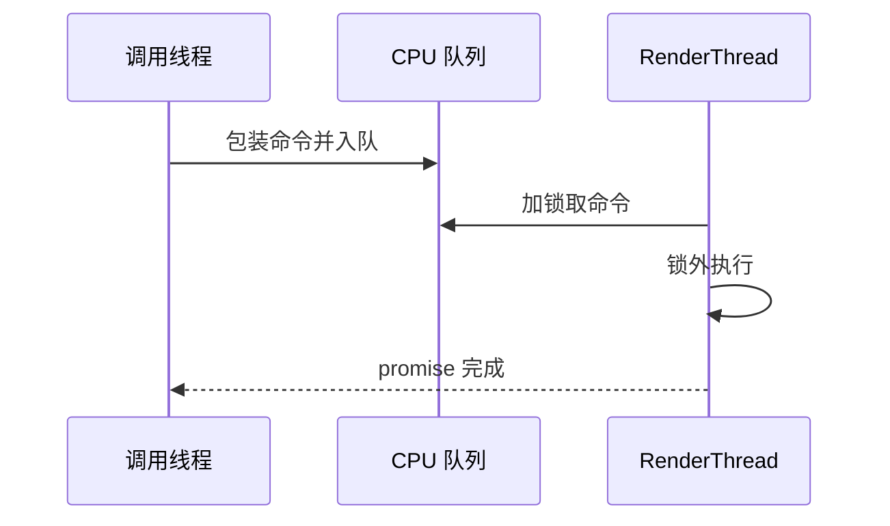

# CPU 任务池与渲染线程

架构入口：[Core](../../architecture/core.md)、[RenderCore](../../architecture/render/rendercore.md)。源码核对，不代表并发压力测试通过。

## 入口和线程归属

| 源码 | 关键符号 | 执行者 |
| --- | --- | --- |
| [TaskPool.h](../../../src/Framework/Core/PublicHeader/TaskPool.h)、[TaskPool.cpp](../../../src/Framework/Core/Private/TaskPool.cpp) | AddTask、WorkerLoop、WaitAll | 池拥有的 CPU worker |
| [RenderThread.cpp](../../../src/Framework/RenderCore/Private/RenderThread.cpp) | Instance、RHIInstance、ExecuteSync | 两个独立的 RenderThread worker |
| [ThreadInfo.cpp](../../../src/Framework/Core/Private/ThreadInfo.cpp) | 线程 ID 记录 | 记录调用线程身份 |
| [RenderGraphBuilder.cpp](../../../src/Framework/RenderCore/Private/RenderGraphBuilder.cpp) | ExecutaPasses | 每次执行临时创建的 TaskPool |

RenderThread、TaskPool、OpenGL 的 context worker 是三种不同用途的线程设施。名称里有 RHIInstance，不表示所有后端原生调用都经过该线程；必须搜索 EnqueueRHICommand 的实际调用方。

## TaskPool 的生产、消费和完成

1. AddTask 为任务创建 promise 与 shared_future，分配单调 ID。
2. 在 m_QueueMutex 内入队并增加 m_PendingTasks，notify_one 唤醒 worker。
3. worker 在同一互斥量下等待“停止或队列非空”，取出任务后释放锁再执行，避免长任务阻塞生产者。
4. 成功 set_value；异常被捕获并 set_exception。随后 pending 减一、通知等待者。
5. 析构先置 shutdown、唤醒，再 join。worker 仅在 shutdown 且队列为空时退出，所以已排队工作会继续执行。

TaskHandle::IsCompleted 查询 future 是否就绪；Wait、WaitAll(handles) 使用 wait 而非 get。因此它们只等待执行结束，**不会重新抛出任务异常**。异常保存在公开的 Future 中，调用方若需要错误结果，应意识到 wait 返回并不表示任务成功。

WaitAll() 等 pending=0，不只是队列为空：正在执行的任务也计入。它没有建立“此刻起禁止再添加”的提交屏障；并发提交与等待的边界仍由控制方决定。AddTask 也没有停止后的拒绝检查，不能在析构同时继续投递。

## RenderThread 的队列协议

EnqueueCommand 在锁内复制 RenderCommand 入队，ThreadFunc 锁外调用 Execute。循环试图在停止后排空剩余命令。ExecuteSync 用栈上 promise 包装命令，入队后由调用线程等待，promise 必须由 worker 执行成功后置为完成。

这张图只表示 CPU 函数完成。若函数提交了 GPU 命令，仍须使用 RHI 队列完成点判断 GPU 是否完成。

## 当前限制与审查重点

- TaskPool worker 减少 m_PendingTasks 并通知 m_PendingCv 时没有持 m_QueueMutex，而 WaitAll() 在该锁内检查谓词再等待。若最后一次完成恰好落在“谓词检查失败”和“进入等待”之间，存在丢失唤醒窗口；atomic 计数不等于条件变量协议已经完整。这是源码层面的时序风险，本轮没有运行复现。
- ExecuteSync 未检测“调用者就是目标 worker”；从该 worker 同步投递给自身会形成自等。
- RenderThread 包装函数没有异常处理。命令在 set_value 前抛异常时，不能声称能正常向等待方传播；worker 的未捕获异常还可能终止进程。
- ThreadFunc 的外层条件读取 m_CommandQueue.empty() 时没有持队列锁，按标准容器并发规则存在竞态风险；锁内取队列并不修复锁外读取。
- StopRenderThread 先停止 RHIInstance，再停止 Instance。若后者的剩余命令仍向前者投递，必须检查关闭顺序，不能把 join 当作跨队列依赖证明。
- RDG 每次 ExecutaPasses 构造线程池，每个拓扑组投递一个任务；并非组内每个 Pass 一个任务，也不是持久 worker 池。频繁线程创建与组内串行成本都真实存在。
- 距离场的切片任务捕获 data、bvh 的引用，调用方必须等任务结束后才能离开其作用域；其随机数生成仍使用 rand，不能宣称并行结果可重复。

验证入口：现有 MaterialContractTest/AssetOwnershipTest 仅覆盖部分资源契约，不是上述线程设施的完整压力测试。检查死锁时画出“谁持锁、谁等待哪个 worker、worker 是否还能继续执行”，不要通过新增 WaitIdle 掩盖 CPU 等待环。
