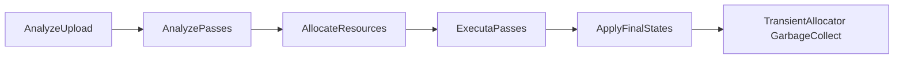

# RDG：从参数声明到队列提交

架构：[RenderCore](../../architecture/render/rendercore.md)。源码：[RenderGraphBuilder.h](../../../src/Framework/RenderCore/PublicHeader/RenderGraphBuilder.h)、[实现](../../../src/Framework/RenderCore/Private/RenderGraphBuilder.cpp)、[Pass](../../../src/Framework/RenderCore/PublicHeader/RenderGraphPass.h)、[Tracker](../../../src/Framework/RenderCore/PublicHeader/RenderResourceTracker.h)。

## 输入和产物

AddPass 保存名称、参数指针、反射元数据、graphics/compute 标志及执行闭包。SetupPassInternal 递归扫描参数，区分 SRV/UAV、渲染目标、嵌套参数等，形成 TextureIntent/BufferIntent。它不是从 Shader 机器码自动推测资源访问。

图内纹理/缓冲以描述符创建；外部资源注册时借用 RenderTexture/RenderBuffer 的 RHI 对象、Tracker 和 ViewCache。名称缓存与原生资源身份是不同维度，当前材质绑定用实际 RHI 地址区分同名纹理替换。

## Execute 的真实顺序

AnalyzeUpload 把待上传数据与使用它的 Pass 联系起来；上传数据本身先复制进 Builder arena，避免引用调用者临时数组。立即/延迟上传策略不是 GPU 的同步/异步开关。

## 依赖、屏障和生命周期分析

每个纹理键使用“RDG Texture 指针 + 精确 SubresourceRange”，缓冲键使用指针。遍历声明顺序时记录 LastVisitor、LastAccess、FirstPass、LastPass 和 begin/end 序号。

当前实现将同一键的连续访问者串联，包含只读访问；并非完整的多 reader 并发调度器。Unknown→已知、访问变化及 UAV 相关访问决定是否创建 transition。不同但重叠的子资源 range 没有统一拆成不相交区间，所以不能声称任意混合 range 都精确合并。

随后按入度做分层拓扑分组。若没有零入度节点，源码选择一个剩余节点继续，而不是明确拒绝环；因此“形成分组”不是无环依赖已经被证明。独立节点遍历来自 unordered 容器，不能依赖稳定顺序表达隐藏副作用。

图的 begin/end 是逻辑 Pass 序号，不是跨帧、跨队列的物理内存可复用证明。

## 分配、录制和提交

仅为实际使用的图内资源向 GTransientResourceAllocator 申请资源，创建视图使用相应 ViewCache。外部对象跳过物理分配。allocator 和 backend 复用条件见 [内存专题](04-memory-and-transient-resources.md)。

每个拓扑组作为一个 CPU task 录制，在组内按 Pass 顺序执行闭包，按逻辑队列维护命令列表。该组各 Pass 的 begin barriers 先收集并合并到组开始；录制全部 task 后等待 CPU 完成，再顺序提交 recordedGroups。

提交时将之前各其他逻辑队列的最新 timeline 值作为等待，策略较保守，不是只针对精确依赖边提交等待。后端是否兑现 QueueType-only 等待必须结合 [队列专题](02-rhi-queues-and-sync.md) 核对。

## 状态记录与完成记录必须分开

ExecuteContext 返回后，代码在实际提交处对 m_PassLastUseResources 更新 UpdateLastAccessFence；ApplyFinalStates 再写最终资源访问状态。Tracker 记录“已声明/提交到何处”，其写入本身不等待 GPU。

当前每个队列提交后会遍历整个 Pass 组的最后使用资源，需注意混合 graphics/compute 组可能把其他队列资源写入当前 fence；本轮仅记录实际代码，未修正。用户要求的显式状态转换仍应在正确队列/访问点维护，不能另加一个全局 retained 列表替代它。

TextureSubresourceStateContainer 有 whole 默认状态与按键覆盖；对 whole 范围查询不会计算所有覆盖的并集。调用方不能把 whole 查询解释为“所有子资源都处于这个状态”。

## RHITransition 对象与原生屏障

[RHITransition.h](../../../src/Framework/RHI/PublicHeader/RHITransition.h) 用“公共头 + 按偏移放置的后端私有数据”表达一次显式转换。G_RHITransition_TotalSize/PrivateDataOffset 在后端初始化时设定；调用方分配相应空间、placement-new，再调用 RHICreateTransition 构造私有数据。释放私有对象与释放外层字节空间也是两个步骤，不能混用 delete 类型或提前释放延迟命令仍引用的 transition。

MarkBegin/MarkEnd 用 atomic.exchange 保证各阶段首次触发；这只约束 CPU 对象的 Begin/End 调用，不是 GPU 已完成转换的信号。每条 info 的 AccessBefore/After、QueueTypeBefore/After 和子资源范围才是原生 stage/access/layout 与队列所有权转换的输入。

Vulkan 中即使还存在 ImageLayoutManager 相关代码，也不能将其当成当前主链自动维护布局的依据。项目显式 RHITransition 与 Tracker 约定仍由实际访问方维护；不能为跑通路径擅自重新接入另一套隐式布局管理。

## CPU arena 与已知释放问题

RenderGraphAllocator 复用页面，按对齐分配；Allocate<T> 记录非平凡对象析构，Reset 逆序析构后重置页游标，析构再 free 页面。对齐在页内处理，并不等价于为任意过大/过度对齐请求提供专门页面。

当前 AddPass 使用 new；Builder 析构只清空裸指针 Pass 列表，不销毁 Pass。**这是现有泄漏，不是生命周期设计或 GPU 安全保证。** 先前新增 m_PassOwners/retained 管理已撤回，本专题不把它描述为现行实现，也不在整理文档时修复 RDG。

验证入口：RenderGraphBuildTest 覆盖纹理 compute copy 与呈现；既往运行完成 1000 帧但有 Shader 生成/校验错误。Launcher 经过更多场景 Pass，但仍不是资源别名、循环依赖、混合队列和销毁压力的完备验证。
